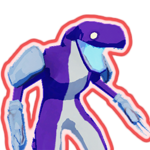
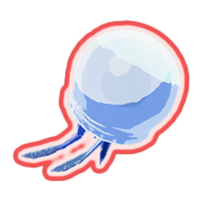
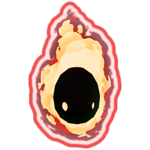
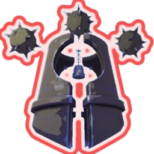
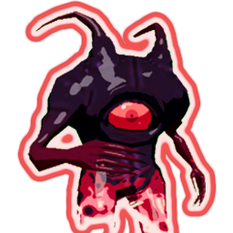
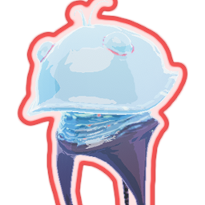
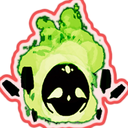
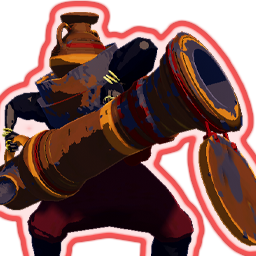
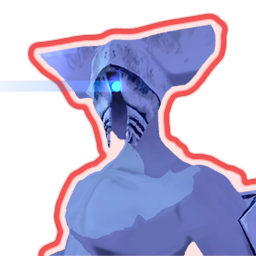

# swuff's refreshed icons

re-renders a bunch of monsters to be more dynamic and vibrant. currently includes:

| Lemurian | Jellyfish | Lesser Wisp | [Clay Man](https://old.thunderstore.io/package/Moffein/Clay_Men/) | Brass Contraption |
| --- | --- | --- | --- | --- |
|  |  |  | ](https://github.com/swuff-star/FasterProcChains/blob/swufficons/swuffIcons/swuffIconsUnity/Assets/texIconClayBody.png) |  |
| Imp | Wandering Vagrant | Greater Wisp | Clay Templar | Mithrix |
|  |  |  |  |  |

and may include more in the future.

CREDITS

swuff★ - renders

gummies139 - lots of feedback
